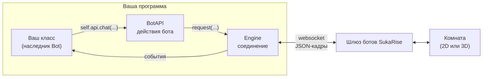
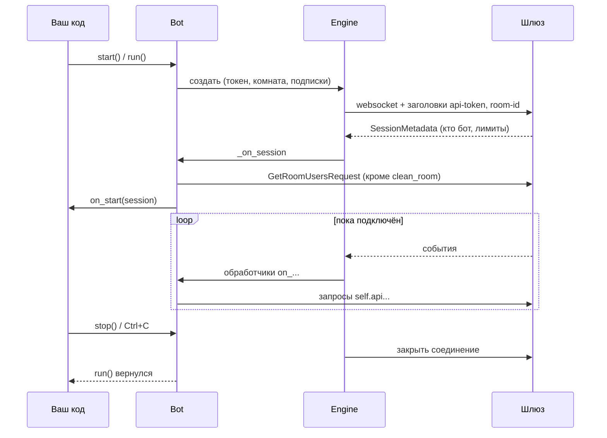
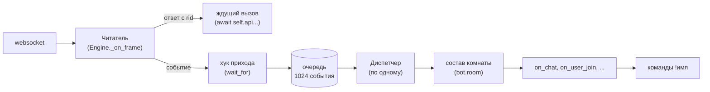
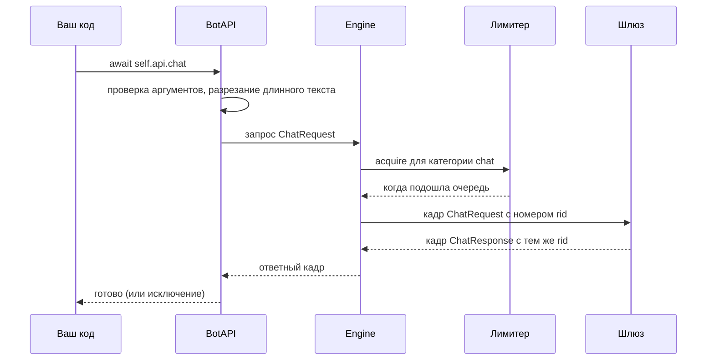
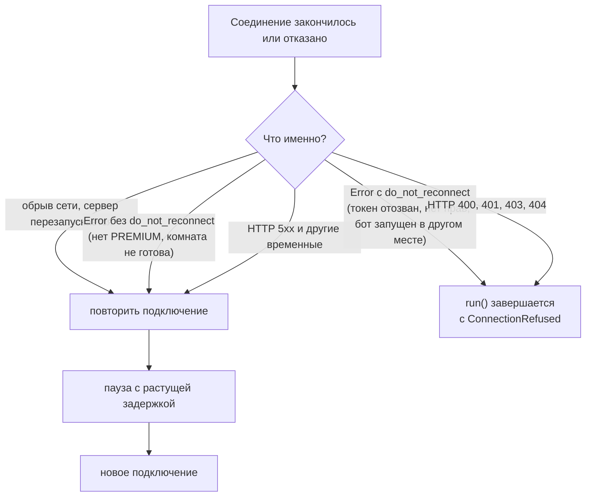

# Устройство SDK

Эта страница объясняет, как SDK работает внутри: из каких частей состоит, как
событие доходит до вашего кода и как запрос доходит до сервера. Писать ботов можно
и без неё, но с ней легче понять поведение бота в необычных ситуациях: когда
обработчик «завис», когда пропало соединение, когда бот ждёт ответ.

## Общая картина

Бот — это аккаунт SukaRise, которым управляет программа. Программа держит **один
websocket** до шлюза ботов SukaRise. По нему в обе стороны идут кадры — JSON-объекты
с полем `_type`.

- Вы пишете **класс-наследник `Bot`**. В нём обработчики `on_...`, команды и таймеры.
- Чтобы что-то сделать (сказать, пойти, выгнать), бот вызывает метод **`BotAPI`**
  (`self.api`). Каждый метод — один запрос к серверу.
- **`Engine`** — низкоуровневая часть: держит websocket, нумерует запросы, ждёт
  ответы, принимает события, переподключается.
- Шлюз SukaRise превращает запросы бота в действия в комнате, а события комнаты —
  в кадры для бота. Бот в комнате ведёт себя как игрок: у него есть аккаунт, положение
  и внешность, и он подчиняется тем же правилам, что и человек.

## Карта модулей

| Модуль | Что в нём | Нужен ли вам напрямую |
|---|---|---|
| `bot.py` | `Bot`: запуск, обработчики, команды, таймеры, `wait_for`, состояние | **Да**, это основа |
| `api.py` | `BotAPI`: все действия бота; `split_message` | **Да** |
| `models.py` | Данные: `User`, `Position`, `Item`, классы событий `*Event`, литералы `Reaction`, `GoldBar` и др. | **Да** |
| `commands.py` | `Context`, `Phrases`, реестр команд | `Context` и `Phrases` — да |
| `decorators.py` | `@command` и `@every` | **Да** |
| `errors.py` | Иерархия исключений | **Да** |
| `room.py` | `Room`: кто в комнате (`bot.room`) | Читать — да |
| `storage.py` | `JsonStore`: данные между запусками | По желанию |
| `outfit.py` | Проверка наряда | Редко |
| `testing.py` | `Harness`: тесты без сервера | В тестах |
| `cli.py`, `__main__.py` | Запуск `python -m sukarisebot` | Для запуска |
| `engine.py` | `Engine`: websocket, очередь, переподключение, keepalive | Нет |
| `protocol.py` | Кодирование и разбор кадров | Нет |
| `limits.py` | Ограничитель частоты запросов | Нет |

Всё нужное для работы экспортируется из пакета: `from sukarisebot import Bot, ...`.

## Жизнь бота: от запуска до остановки

1. `start()` (блокирующий) или `run()` (корутина) создаёт `Engine` и запускает его.
2. Движок подключается и ждёт от шлюза первый кадр — **`SessionMetadata`**. Если
   вместо него пришёл `Error`, подключение отклонено (см. «Переподключение» ниже).
3. `SessionMetadata` попадает в очередь и обрабатывается первым: бот обнуляет состав
   комнаты, запускает таймеры, загружает список людей (`refresh_room`, если не
   «чистая комната») и вызывает **`on_start`**.
4. Дальше события идут по одному в обработчики, а ваш код отправляет запросы.
5. `stop()` закрывает соединение, `run()` возвращается. Таймеры и общий HTTP-клиент
   (`bot.http`) закрываются сами.

При каждом **переподключении** шаги 2–3 повторяются: заново приходит
`SessionMetadata`, состав комнаты загружается заново, снова вызывается `on_start`.
Пишите `on_start` так, чтобы повторный вызов был безопасен.

## Как событие доходит до обработчика

Три важных свойства.

**1. Читатель никогда не ждёт ваш код.** Он принимает кадры из сокета. Ответ на
запрос (кадр с `rid`) он сразу передаёт тому, кто ждёт этот ответ. Событие ставит в
очередь.

**2. Обработчики выполняются по одному, строго в порядке прихода.** Диспетчер берёт
событие из очереди и ждёт, пока завершатся его `on_...` и команда. Только потом он
возьмёт следующее. Это даёт важную гарантию: обработчики событий и команды никогда не
выполняются одновременно друг с другом, поэтому общие данные (`self.state`) не требуют
блокировок. Исключение — таймеры `@every`: каждый работает в своей задаче и может
выполняться между `await` другого обработчика.

Цена этой гарантии: **долгий обработчик задерживает все события после него.** Если
обработчик ждёт ответа игрока 60 секунд, всё это время бот не реагирует ни на чат, ни на
входы. Правила:

- не пишите в обработчиках `time.sleep` и долгие синхронные вычисления — они блокируют
  весь цикл событий; используйте `await asyncio.sleep(...)` и `asyncio.to_thread(...)`;
- долгую работу и диалоги с несколькими игроками выносите в отдельные задачи
  (`asyncio.create_task`, см. [Команды и диалоги](commands.md));
- у `wait_for` всегда ставьте `timeout`.

**3. Очередь ограничена.** Она вмещает 1024 события. Если обработчики не успевают и
очередь заполнилась, **самое старое событие отбрасывается** (счётчик
`engine.dropped_events` растёт, в журнал попадает предупреждение). Так сделано
намеренно: сервер отключает бота, который отстаёт слишком сильно, и оставаться на связи
важнее, чем доставить устаревшее событие.

### Ожидание ответа (`wait_for`) и хук прихода

`wait_for` ждёт *следующее* событие нужного типа. Но обработчик, который ждёт, сам
занимает диспетчера, поэтому событие, которого он ждёт, не может дойти до него через
очередь. Чтобы это работало, ожидание срабатывает **в момент прихода кадра**, ещё
до очереди (хук `on_arrival` у движка). После этого событие всё равно проходит по
обычному пути: обработчики `on_...` и команды увидят его, когда дойдёт очередь.

### Исключения в обработчиках

Каждый обработчик, команда и таймер запускаются под защитой: исключение не
останавливает ни диспетчера, ни бота. Оно передаётся в **`on_error(error, event)`**;
по умолчанию пишется в журнал `sukarisebot` с трассировкой. Если упадёт сам
`on_error`, это тоже попадёт в журнал, и бот продолжит работу.

## Подписки на события

Сервер присылает боту только те события, на которые он подписан. SDK подписывает бота
**автоматически** — на те события, для которых вы переопределили обработчик:

| Обработчик | Подписка на сервере |
|---|---|
| `on_chat`, `on_whisper` | `chat` (включена всегда: нужна командам) |
| `on_emote` | `emote` |
| `on_reaction` | `reaction` |
| `on_user_join` | `user_joined` |
| `on_user_leave` | `user_left` |
| `on_user_move` | `user_moved` |
| `on_channel` | `channel` |
| `on_moderate` | `moderation` |
| `on_tip` | `tip_reaction` |
| `on_message` | `message` |

Подписки уходят в параметре адреса `?events=chat,user_joined`. Следствие: если вы не
переопределили, например, `on_user_move`, перемещения до бота не дойдут вовсе — ни по
сети, ни в очередь. Это экономит трафик, но влияет и на `bot.room`:
**состав комнаты обновляется только теми событиями, на которые подписан бот**
(подробнее — в [«Инструменты»](tools.md#состав-комнаты-botroom)).

## Запрос и ответ

1. **Проверка аргументов.** `BotAPI` проверяет аргументы до отправки. Ошибка даёт
   `InvalidArgument` в вашей строке кода, а не отказ сервера позже.
2. **Лимитер.** Сервер задаёт бюджеты запросов по категориям (см. ниже). Движок ведёт
   такие же счётчики и ждёт, пока в категории появится место. Отказ с повтором всегда
   дольше, чем короткое ожидание, поэтому SDK ждёт сам.
3. **Номер `rid`.** Каждый запрос получает номер. Сервер возвращает его в ответе, так
   ответ находит ждущий его вызов — даже если ответы приходят не по порядку.
4. **Ожидание.** Вызов ждёт ответ до 10 секунд. Не дождался — `RequestTimeout`.
5. **Отказ.** Если сервер вместо ответа присылает `Error` с тем же `rid`, вызов
   получает `ResponseError` с текстом отказа.

### Лимиты частоты

Сервер сообщает бюджет в `SessionMetadata.rate_limits` — пары «запросов за секунд» по
категориям. Типичные значения шлюза SukaRise:

| Категория | Какие методы | Лимит |
|---|---|---|
| `chat` | `chat`, `whisper` | 20 за 10 с |
| `channel` | `channel` | 20 за 10 с |
| `emote` | `emote`, `react` | 20 за 10 с |
| `move` | `move_to`, `sit_on` | 20 за 10 с |
| `teleport` | `teleport_user` | 10 за 10 с |
| `moderate` | `moderate`, `kick`, `ban`, `unban`, `mute`, `set_privileges` | 10 за 10 с |
| `tip` | `tip` | 10 за 10 с |
| `message` | `send_message`, `send_bulk_message`, `leave_conversation` | 10 за 10 с |
| `shop` | `buy_item` | 10 за 10 с |
| `info` | все остальные запросы на чтение и `wear` | 30 за 10 с |

Реальные числа всегда берутся из `session.rate_limits`; таблица — для ориентира.
Каждая категория — «ведро»: оно вмещает столько жетонов, сколько разрешено запросов, и
равномерно пополняется. Короткий всплеск разрешён, длинный поток выравнивается.

## Переподключение

Если соединение оборвалось, движок подключается заново (если не указан
`reconnect=False`). Пауза растёт: 0,5 с, 1 с, 2 с, … до 30 с, со случайным разбросом
от 50 до 100 %. Если соединение продержалось дольше 30 секунд, отсчёт начинается
заново.

Не всякий отказ означает «повторять не стоит». Решает слово сервера — признак
**`do_not_reconnect`** в кадре `Error`:

Поэтому бот, у владельца которого закончился PREMIUM, не завершается: он тихо
повторяет попытки и подключится после продления подписки. А бот, токен которого
отозван, завершается сразу с `ConnectionRefused`.

Если бот запущен одновременно из двух мест с одним токеном, побеждает **новое**
подключение, а старое получает окончательный отказ «This bot connected from another
place». Так два процесса с одним токеном не будут бесконечно вытеснять друг друга.

## Keepalive

Раз в 20 секунд движок отправляет `KeepaliveRequest`, чтобы сервер не счёл бота
ушедшим (на стороне шлюза простой допускается не дольше минуты). Этот запрос не
нумеруется и не считается в лимитах.

## Состояние бота

| Что | Где | Живёт |
|---|---|---|
| Состав комнаты | `bot.room` | пока подключён; обновляется событиями |
| Данные бота | `bot.state` (словарь) | пока работает процесс |
| Данные по игроку | `bot.user_state(user_id)` | пока работает процесс |
| Данные между запусками | `JsonStore` (файл JSON) | на диске |
| HTTP-клиент | `bot.http` | пока работает бот |

В памяти ничего не сохраняется между запусками: для постоянных данных используйте
`JsonStore` (см. [«Инструменты»](tools.md#jsonstore-данные-между-запусками)).

## Строгая типизация

SDK написан под строгую проверку типов и проверяется `mypy --strict` и
`pyright` в режиме `strict`. Это значит:

- у всех публичных функций и атрибутов есть типы; пакет помечен как типизированный
  (файл `py.typed`), поэтому редактор и анализатор типов видят их в вашем коде;
- данные, которые SDK отдаёт вам, — **неизменяемые** dataclass'ы (`frozen=True`,
  `slots=True`): их нельзя случайно испортить, их безопасно хранить и сравнивать;
- «одно из нескольких значений» описано литералами (`Reaction`, `GoldBar`,
  `Facing`, `ModerationAction`) — редактор подсказывает допустимые значения, а
  анализатор ловит опечатку;
- «или то, или это» описано объединениями: положение `Location` — это `Position`
  или `AnchorPosition`, событие `Event` — одно из десяти `*Event`. Разбирайте их через
  `isinstance` или `match`.

Подробнее о настройке редактора — в [«Редакторы и подсказки»](editors.md).
