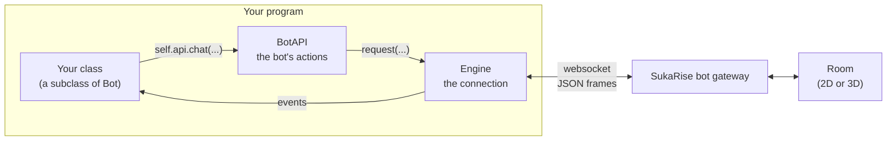
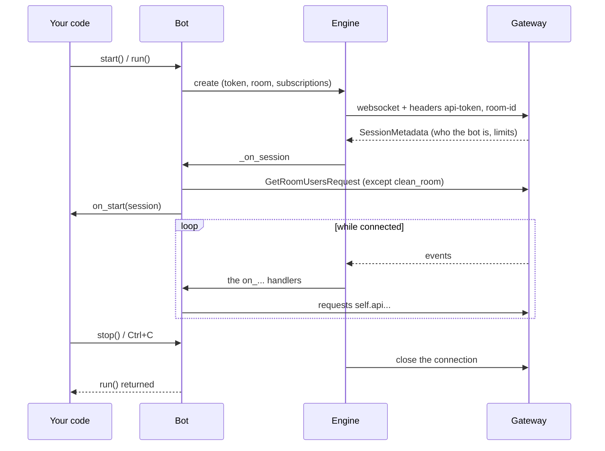
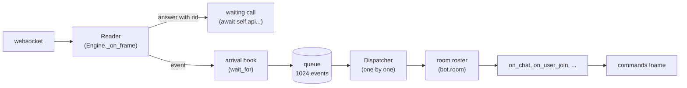
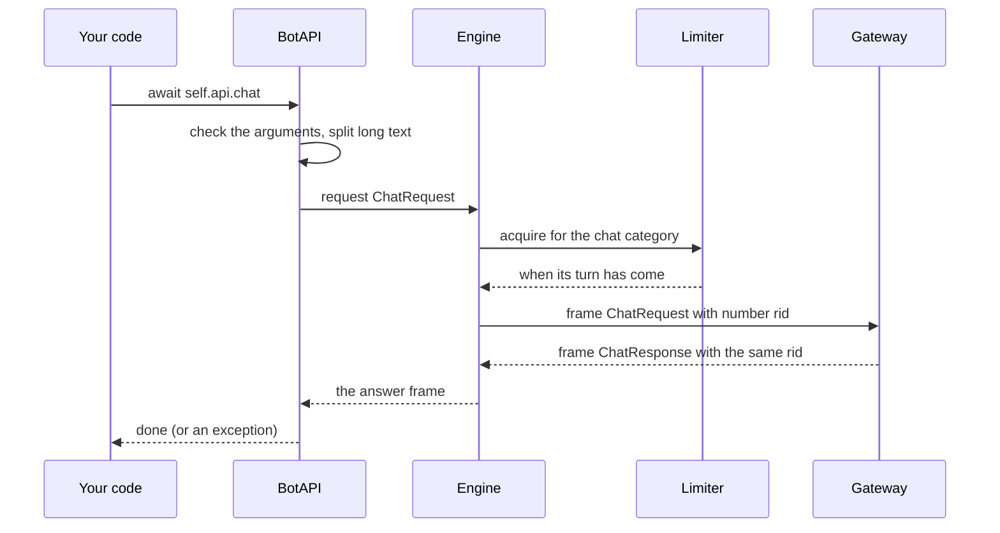
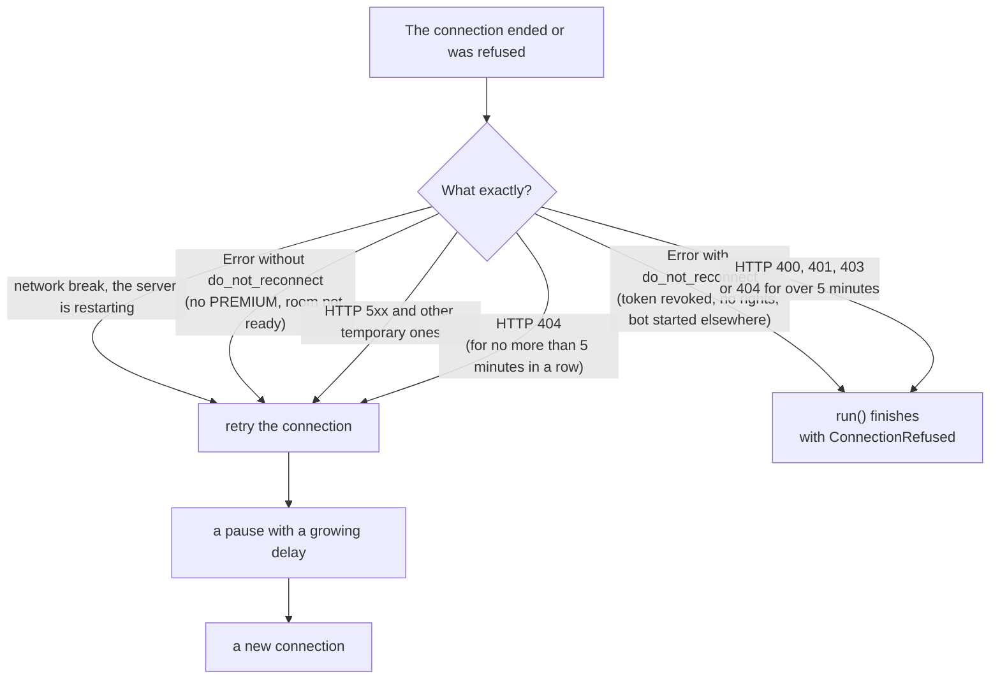

**English** | [Русский](../ru/architecture.md) | [Português (Brasil)](../pt-BR/architecture.md)

# How the SDK works

This page explains how the SDK works inside: what parts it consists of, how an event reaches
your code and how a request reaches the server. You can write bots without it, but with it the
behaviour of a bot in unusual situations is easier to understand: when a handler "hangs", when
the connection is lost, when the bot waits for an answer.

## The big picture

A bot is a SukaRise account driven by a program. The program holds **one websocket** to the
SukaRise bot gateway. Frames go both ways over it: JSON objects with a `_type` field.

- You write a **subclass of `Bot`**. It holds the `on_...` handlers, commands and timers.
- To do something (say, walk, kick), the bot calls a method of **`BotAPI`** (`self.api`). Each
  method is one request to the server.
- **`Engine`** is the low-level part: it holds the websocket, numbers the requests, waits for
  answers, receives events and reconnects.
- The SukaRise gateway turns the bot's requests into actions in the room and the room's events
  into frames for the bot. In the room the bot behaves like a player: it has an account, a
  position and an appearance, and obeys the same rules as a person.

## Map of the modules

| Module | What is in it | Do you need it directly |
|---|---|---|
| `bot.py` | `Bot`: start, handlers, commands, timers, `wait_for`, state | **Yes**, it is the base |
| `api.py` | `BotAPI`: all the bot's actions; `split_message` | **Yes** |
| `models.py` | Data: `User`, `Position`, `Item`, the `*Event` classes, the literals `Reaction`, `GoldBar` and others | **Yes** |
| `commands.py` | `Context`, `Phrases`, the command registry | `Context` and `Phrases`: yes |
| `decorators.py` | `@command` and `@every` | **Yes** |
| `errors.py` | The exception hierarchy | **Yes** |
| `room.py` | `Room`: who is in the room (`bot.room`) | To read: yes |
| `storage.py` | `JsonStore`: data between runs | Optional |
| `outfit.py` | The outfit check | Rarely |
| `testing.py` | `Harness`: tests without a server | In tests |
| `cli.py`, `__main__.py` | Starting with `python -m sukarisebot` | To start a bot |
| `engine.py` | `Engine`: websocket, queue, reconnection, keepalive | No |
| `protocol.py` | Encoding and decoding frames | No |
| `limits.py` | The request rate limiter | No |

Everything needed for work is exported from the package: `from sukarisebot import Bot, ...`.

## A bot's life: from start to stop

1. `start()` (blocking) or `run()` (a coroutine) creates an `Engine` and starts it.
2. The engine connects and waits for the gateway's first frame: **`SessionMetadata`**. If an
   `Error` arrives instead, the connection is refused (see "Reconnection" below).
3. `SessionMetadata` goes into the queue and is handled first: the bot clears the room roster,
   starts the timers, loads the list of people (`refresh_room`, unless "clean room") and calls
   **`on_start`**.
4. After that events go one by one to the handlers, and your code sends requests.
5. `stop()` closes the connection and `run()` returns. The timers and the shared HTTP client
   (`bot.http`) are closed by themselves.

On every **reconnection** steps 2–3 repeat: a new `SessionMetadata` arrives, the room roster is
loaded again, `on_start` is called again. Write `on_start` so that a repeated call is safe.

## How an event reaches a handler

Three important properties.

**1. The reader never waits for your code.** It receives frames from the socket. It hands the
answer to a request (a frame with `rid`) straight to whoever waits for it. It puts an event into
the queue.

**2. Handlers run one at a time, strictly in order of arrival.** The dispatcher takes an event
from the queue and waits until its `on_...` and its command have finished. Only then does it
take the next one. This gives an important guarantee: event handlers and commands never run at
the same time as each other, so shared data (`self.state`) needs no locks. The exception is the
`@every` timers: each works in its own task and may run between another handler's `await`s.

The price of this guarantee: **a long handler delays all the events after it.** If a handler
waits 60 seconds for a player's answer, for all that time the bot reacts to neither chat nor
joins. The rules:

- do not write `time.sleep` or long synchronous computations in handlers: they block the whole
  event loop; use `await asyncio.sleep(...)` and `asyncio.to_thread(...)`;
- move long work and dialogues with several players into separate tasks
  (`asyncio.create_task`, see [Commands and dialogues](commands.md));
- always give `wait_for` a `timeout`.

**3. The queue is bounded.** It holds 1024 events. If handlers cannot keep up and the queue
fills, **the oldest event is dropped** (the `engine.dropped_events` counter grows and a warning
goes to the log). This is deliberate: the server disconnects a bot that falls too far behind,
and staying connected matters more than delivering a stale event.

### Waiting for an answer (`wait_for`) and the arrival hook

`wait_for` waits for the *next* event of the wanted type. But a handler that waits occupies the
dispatcher itself, so the event it waits for cannot reach it through the queue. To make this
work, the wait fires **at the moment the frame arrives**, even before the queue (the engine's
`on_arrival` hook). After that the event still goes the usual way: the `on_...` handlers and
commands will see it when its turn in the queue comes.

### Exceptions in handlers

Every handler, command and timer runs under protection: an exception stops neither the
dispatcher nor the bot. It is passed to **`on_error(error, event)`**; by default it is written
to the `sukarisebot` log with a traceback. If `on_error` itself fails, that too goes to the log
and the bot carries on.

## Event subscriptions

The server sends a bot only the events it is subscribed to. The SDK subscribes the bot
**automatically**: to the events you have overridden a handler for, and to a few events the bot
cannot work without:

| Handler | Subscription on the server |
|---|---|
| `on_chat`, `on_whisper` | `chat` (always on: commands need it) |
| `on_emote` | `emote` |
| `on_reaction` | `reaction` |
| `on_user_join` | `user_joined` (always on except in "clean room": `bot.room` needs it) |
| `on_user_leave` | `user_left` (always on except in "clean room": `bot.room` needs it) |
| `on_user_move` | `user_moved` |
| `on_channel` | `channel` |
| `on_moderate` | `moderation` |
| `on_tip` | `tip_reaction` |
| `on_message` | `message` |

The subscriptions go in the address parameter `?events=chat,user_joined,user_left`. The
consequence: if you have not overridden, say, `on_user_move`, people's movements never reach the
bot at all, neither over the network nor into the queue. This saves traffic, but it also affects
`bot.room`: **the roster always sees people joining and leaving, but their movements only with
`on_user_move`** (more in [Tools](tools.md#the-room-roster-botroom)). Earlier the roster followed
both joins and leaves only when `on_user_join` and `on_user_leave` were overridden.

## Request and answer

1. **Argument check.** `BotAPI` checks the arguments before sending. A mistake raises
   `InvalidArgument` on your line of code, not a server refusal later.
2. **Limiter.** The server sets request budgets per category (see below). The engine keeps the
   same counters and waits until there is room in the category. A refusal followed by a retry is
   always longer than a short wait, so the SDK waits by itself.
3. **The `rid` number.** Each request gets a number. The server returns it in the answer, so the
   answer finds the call waiting for it, even if answers arrive out of order.
4. **Waiting.** A call waits up to 10 seconds for the answer. If none comes: `RequestTimeout`.
5. **Refusal.** If the server sends an `Error` with the same `rid` instead of an answer, the
   call gets a `ResponseError` with the refusal text. A refusal because of the rate limit
   (`RateLimited`) is first retried by the engine itself: up to three times with a pause of one
   second.

### Rate limits

The server reports the budget in `SessionMetadata.rate_limits`: pairs of "requests per seconds"
per category. Typical values of the SukaRise gateway:

| Category | Which methods | Limit |
|---|---|---|
| `chat` | `chat`, `whisper` | 20 per 10 s |
| `channel` | `channel` | 20 per 10 s |
| `emote` | `emote`, `react` | 20 per 10 s |
| `move` | `move_to`, `sit_on` | 20 per 10 s |
| `teleport` | `teleport_user` | 10 per 10 s |
| `moderate` | `moderate`, `kick`, `ban`, `unban`, `mute`, `set_privileges` | 10 per 10 s |
| `tip` | `tip` | 10 per 10 s |
| `message` | `send_message`, `send_bulk_message`, `leave_conversation` | 10 per 10 s |
| `shop` | `buy_item` | 10 per 10 s |
| `info` | all the other read requests and `wear` | 30 per 10 s |

The real numbers are always taken from `session.rate_limits`; the table is for orientation. Each
category is a "bucket": it holds as many tokens as there are allowed requests and refills evenly.
A short burst is allowed, a long stream is evened out.

## Reconnection

If the connection breaks, the engine connects again (unless `reconnect=False` is given). The
pause grows: 0.5 s, 1 s, 2 s, … up to 30 s, with a random spread of 50 to 100 %. If the
connection lasted longer than 30 seconds, the count starts over.

Not every refusal means "do not retry". The server's word decides: the **`do_not_reconnect`**
flag in the `Error` frame:

That is why a bot whose owner's PREMIUM has ended does not finish: it quietly keeps trying and
connects once the subscription is renewed. And a bot whose token was revoked finishes at once
with `ConnectionRefused`.

An HTTP 404 answer is a special case. While the server is being updated the bot API route may be
missing for a few seconds, so a 404 is retried. But if the gateway answers 404 for longer than 5
minutes in a row (the `not_found_grace` parameter of `Engine`), the address is wrong: `run()`
finishes with `ConnectionRefused` and a hint to check `SUKARISEBOT_URL`.

If a bot is started from two places at once with the same token, the **new** connection wins, and
the old one gets a final refusal "This bot connected from another place". This way two processes
with one token do not keep evicting each other.

## Keepalive

Every 20 seconds the engine sends a `KeepaliveRequest`, so that the server does not consider the
bot gone (the gateway allows idleness of no more than a minute). This request is not numbered
and does not count towards the limits. The engine also watches the other direction: if the
server is silent for longer than three such intervals (about a minute), the connection is
considered lost and the engine connects again.

## The bot's state

| What | Where | Lives |
|---|---|---|
| Room roster | `bot.room` | while connected; updated by events |
| The bot's data | `bot.state` (a dictionary) | while the process runs |
| Per-player data | `bot.user_state(user_id)` | while the process runs |
| Data between runs | `JsonStore` (a JSON file) | on disk |
| HTTP client | `bot.http` | while the bot runs |

Nothing is kept in memory between runs: for permanent data use `JsonStore` (see
[Tools](tools.md#jsonstore-data-between-runs)).

## Strict typing

The SDK is written for strict type checking and is checked with `mypy --strict` and `pyright` in
`strict` mode. This means:

- all public functions and attributes have types; the package is marked as typed (the `py.typed`
  file), so your editor and type checker see them in your code;
- the data the SDK gives you consists of **immutable** dataclasses (`frozen=True`, `slots=True`):
  they cannot be spoiled by accident, and they are safe to store and compare;
- "one of several values" is described with literals (`Reaction`, `GoldBar`, `Facing`,
  `ModerationAction`): the editor suggests the allowed values and the checker catches a typo;
- "this or that" is described with unions: a position `Location` is a `Position` or an
  `AnchorPosition`, an event `Event` is one of the ten `*Event` classes. Take them apart with
  `isinstance` or `match`.

More about setting up your editor is in [Editors and hints](editors.md).
