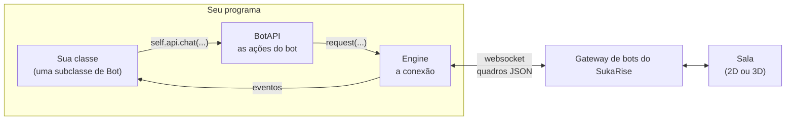
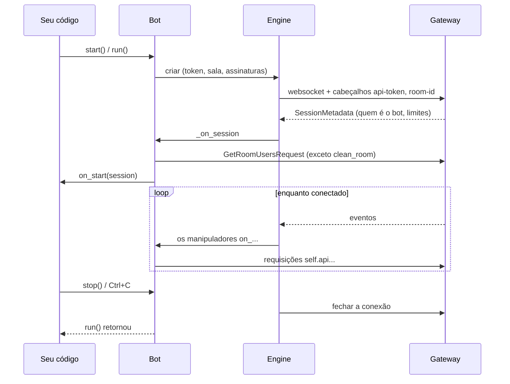
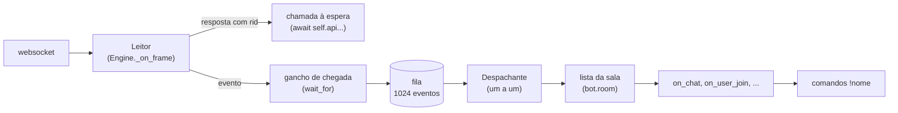
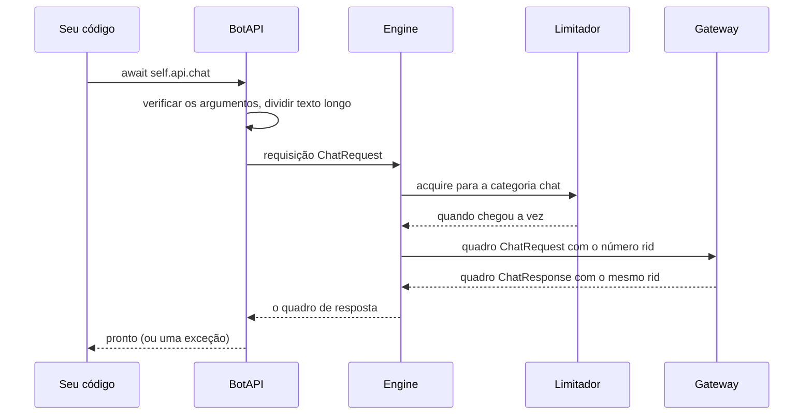
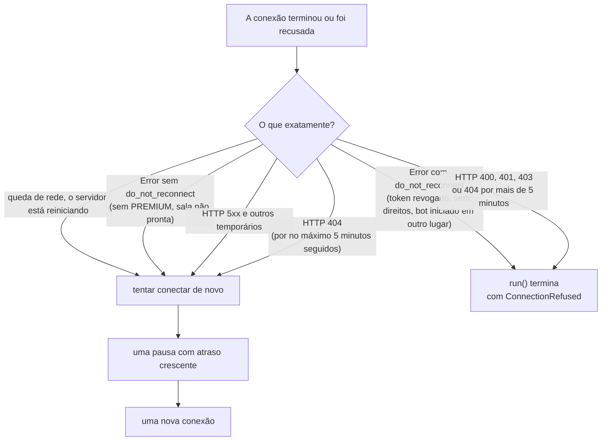

[English](../en/architecture.md) | [Русский](../ru/architecture.md) | **Português (Brasil)**

# Como o SDK funciona

Esta página explica como o SDK funciona por dentro: de que partes ele é feito, como um evento
chega ao seu código e como uma requisição chega ao servidor. Dá para escrever bots sem ela, mas
com ela fica mais fácil entender o comportamento do bot em situações incomuns: quando um
manipulador "trava", quando a conexão cai, quando o bot espera uma resposta.

## Visão geral

Um bot é uma conta do SukaRise controlada por um programa. O programa mantém **um único
websocket** com o gateway de bots do SukaRise. Por ele passam quadros nos dois sentidos: objetos
JSON com o campo `_type`.

- Você escreve uma **subclasse de `Bot`**. Nela ficam os manipuladores `on_...`, os comandos e os
  temporizadores.
- Para fazer algo (falar, andar, expulsar), o bot chama um método da **`BotAPI`** (`self.api`).
  Cada método é uma requisição ao servidor.
- O **`Engine`** é a parte de baixo nível: mantém o websocket, numera as requisições, espera as
  respostas, recebe os eventos e reconecta.
- O gateway do SukaRise transforma as requisições do bot em ações na sala e os eventos da sala
  em quadros para o bot. Na sala o bot se comporta como um jogador: tem conta, posição e
  aparência, e segue as mesmas regras que uma pessoa.

## Mapa dos módulos

| Módulo | O que há nele | Você precisa dele diretamente |
|---|---|---|
| `bot.py` | `Bot`: início, manipuladores, comandos, temporizadores, `wait_for`, estado | **Sim**, é a base |
| `api.py` | `BotAPI`: todas as ações do bot; `split_message` | **Sim** |
| `models.py` | Dados: `User`, `Position`, `Item`, as classes `*Event`, os literais `Reaction`, `GoldBar` e outros | **Sim** |
| `commands.py` | `Context`, `Phrases`, o registro de comandos | `Context` e `Phrases`: sim |
| `decorators.py` | `@command` e `@every` | **Sim** |
| `errors.py` | A hierarquia de exceções | **Sim** |
| `room.py` | `Room`: quem está na sala (`bot.room`) | Para ler: sim |
| `storage.py` | `JsonStore`: dados entre execuções | Opcional |
| `outfit.py` | A verificação da roupa | Raramente |
| `testing.py` | `Harness`: testes sem servidor | Nos testes |
| `cli.py`, `__main__.py` | Início com `python -m sukarisebot` | Para iniciar um bot |
| `engine.py` | `Engine`: websocket, fila, reconexão, keepalive | Não |
| `protocol.py` | Codificação e decodificação dos quadros | Não |
| `limits.py` | O limitador de frequência das requisições | Não |

Tudo o que é necessário para trabalhar é exportado pelo pacote: `from sukarisebot import Bot, ...`.

## A vida de um bot: do início ao fim

1. `start()` (bloqueante) ou `run()` (uma corrotina) cria um `Engine` e o inicia.
2. O engine conecta e espera o primeiro quadro do gateway: **`SessionMetadata`**. Se em vez dele
   chegar um `Error`, a conexão foi recusada (veja "Reconexão" abaixo).
3. O `SessionMetadata` entra na fila e é tratado primeiro: o bot zera a lista da sala, inicia os
   temporizadores, carrega a lista de pessoas (`refresh_room`, exceto em "sala limpa") e chama
   **`on_start`**.
4. Depois disso os eventos vão um a um para os manipuladores, e o seu código envia requisições.
5. `stop()` fecha a conexão e `run()` retorna. Os temporizadores e o cliente HTTP compartilhado
   (`bot.http`) são fechados sozinhos.

A cada **reconexão** os passos 2–3 se repetem: chega um novo `SessionMetadata`, a lista da sala
é carregada de novo, `on_start` é chamado de novo. Escreva o `on_start` de modo que uma chamada
repetida seja segura.

## Como um evento chega a um manipulador

Três propriedades importantes.

**1. O leitor nunca espera o seu código.** Ele recebe os quadros do socket. A resposta a uma
requisição (um quadro com `rid`) ele entrega na hora a quem a espera. Um evento ele coloca na
fila.

**2. Os manipuladores executam um de cada vez, estritamente na ordem de chegada.** O despachante
pega um evento da fila e espera até que o seu `on_...` e o seu comando terminem. Só então pega o
próximo. Isso dá uma garantia importante: manipuladores de eventos e comandos nunca executam ao
mesmo tempo uns com os outros, então os dados compartilhados (`self.state`) não precisam de
travas. A exceção são os temporizadores `@every`: cada um trabalha em sua própria tarefa e pode
executar entre os `await` de outro manipulador.

O preço dessa garantia: **um manipulador demorado atrasa todos os eventos depois dele.** Se um
manipulador espera 60 segundos pela resposta de um jogador, durante todo esse tempo o bot não
reage nem ao chat nem às entradas. As regras:

- não escreva `time.sleep` nem cálculos síncronos longos nos manipuladores: eles bloqueiam todo
  o laço de eventos; use `await asyncio.sleep(...)` e `asyncio.to_thread(...)`;
- leve o trabalho demorado e os diálogos com vários jogadores para tarefas separadas
  (`asyncio.create_task`, veja [Comandos e diálogos](commands.md));
- sempre dê um `timeout` ao `wait_for`.

**3. A fila é limitada.** Ela comporta 1024 eventos. Se os manipuladores não dão conta e a fila
enche, **o evento mais antigo é descartado** (o contador `engine.dropped_events` cresce e um
aviso vai para o log). Isso é proposital: o servidor desconecta um bot que fica atrasado demais, e
continuar conectado importa mais do que entregar um evento ultrapassado.

### Esperando uma resposta (`wait_for`) e o gancho de chegada

O `wait_for` espera o *próximo* evento do tipo desejado. Mas um manipulador que espera ocupa o
próprio despachante, então o evento que ele espera não consegue chegar até ele pela fila. Para
isso funcionar, a espera dispara **no momento em que o quadro chega**, antes mesmo da fila (o
gancho `on_arrival` do engine). Depois disso o evento ainda segue o caminho normal: os
manipuladores `on_...` e os comandos o verão quando chegar a vez dele na fila.

### Exceções nos manipuladores

Todo manipulador, comando e temporizador executa sob proteção: uma exceção não para nem o
despachante nem o bot. Ela é passada a **`on_error(error, event)`**; por padrão é escrita no log
`sukarisebot` com o traceback. Se o próprio `on_error` falhar, isso também vai para o log e o bot
continua.

## Assinaturas de eventos

O servidor envia ao bot apenas os eventos em que ele está inscrito. O SDK inscreve o bot
**automaticamente**: nos eventos para os quais você sobrescreveu um manipulador e em alguns
eventos sem os quais o bot não consegue trabalhar:

| Manipulador | Assinatura no servidor |
|---|---|
| `on_chat`, `on_whisper` | `chat` (sempre ligada: os comandos precisam dela) |
| `on_emote` | `emote` |
| `on_reaction` | `reaction` |
| `on_user_join` | `user_joined` (sempre ligada, exceto em "sala limpa": o `bot.room` precisa dela) |
| `on_user_leave` | `user_left` (sempre ligada, exceto em "sala limpa": o `bot.room` precisa dela) |
| `on_user_move` | `user_moved` |
| `on_channel` | `channel` |
| `on_moderate` | `moderation` |
| `on_tip` | `tip_reaction` |
| `on_message` | `message` |

As assinaturas vão no parâmetro do endereço `?events=chat,user_joined,user_left`. A
consequência: se você não sobrescreveu, por exemplo, `on_user_move`, os movimentos das pessoas
não chegam ao bot de jeito nenhum, nem pela rede nem para a fila. Isso economiza tráfego, mas
também afeta o `bot.room`: **a lista sempre vê as pessoas entrando e saindo, mas os movimentos
delas só com `on_user_move`** (mais em [Ferramentas](tools.md#a-lista-da-sala-botroom)). Antes,
a lista acompanhava entradas e saídas só quando `on_user_join` e `on_user_leave` eram
sobrescritos.

## Requisição e resposta

1. **Verificação dos argumentos.** A `BotAPI` verifica os argumentos antes de enviar. Um erro
   lança `InvalidArgument` na sua linha de código, e não uma recusa do servidor depois.
2. **Limitador.** O servidor define orçamentos de requisições por categoria (veja abaixo). O
   engine mantém os mesmos contadores e espera até haver espaço na categoria. Uma recusa seguida
   de nova tentativa é sempre mais demorada que uma espera curta, então o SDK espera sozinho.
3. **O número `rid`.** Cada requisição recebe um número. O servidor o devolve na resposta, e
   assim a resposta encontra a chamada que a espera, mesmo que as respostas cheguem fora de
   ordem.
4. **Espera.** Uma chamada espera até 10 segundos pela resposta. Se não vier: `RequestTimeout`.
5. **Recusa.** Se o servidor envia um `Error` com o mesmo `rid` em vez de uma resposta, a chamada
   recebe um `ResponseError` com o texto da recusa. Uma recusa por causa do limite de frequência
   (`RateLimited`) é antes repetida pelo próprio engine: até três vezes, com pausa de um
   segundo.

### Limites de frequência

O servidor informa o orçamento em `SessionMetadata.rate_limits`: pares de "requisições por
segundos" por categoria. Valores típicos do gateway do SukaRise:

| Categoria | Quais métodos | Limite |
|---|---|---|
| `chat` | `chat`, `whisper` | 20 em 10 s |
| `channel` | `channel` | 20 em 10 s |
| `emote` | `emote`, `react` | 20 em 10 s |
| `move` | `move_to`, `sit_on` | 20 em 10 s |
| `teleport` | `teleport_user` | 10 em 10 s |
| `moderate` | `moderate`, `kick`, `ban`, `unban`, `mute`, `set_privileges` | 10 em 10 s |
| `tip` | `tip` | 10 em 10 s |
| `message` | `send_message`, `send_bulk_message`, `leave_conversation` | 10 em 10 s |
| `shop` | `buy_item` | 10 em 10 s |
| `info` | todas as outras requisições de leitura e `wear` | 30 em 10 s |

Os números reais são sempre tirados de `session.rate_limits`; a tabela serve de referência. Cada
categoria é um "balde": ele comporta tantas fichas quantas são as requisições permitidas e se
reabastece de modo uniforme. Uma rajada curta é permitida, um fluxo longo é nivelado.

## Reconexão

Se a conexão cair, o engine conecta de novo (a menos que se indique `reconnect=False`). A pausa
cresce: 0,5 s, 1 s, 2 s, … até 30 s, com uma variação aleatória de 50 a 100 %. Se a conexão durou
mais de 30 segundos, a contagem recomeça.

Nem toda recusa significa "não tente de novo". Decide a palavra do servidor: o sinal
**`do_not_reconnect`** no quadro `Error`:

Por isso um bot cujo dono ficou sem PREMIUM não termina: ele continua tentando em silêncio e
conecta quando a assinatura for renovada. Já um bot cujo token foi revogado termina na hora com
`ConnectionRefused`.

A resposta HTTP 404 é um caso especial. Enquanto o servidor é atualizado, a rota da API de bots
pode sumir por alguns segundos, por isso o 404 é repetido. Mas se o gateway responder 404 por
mais de 5 minutos seguidos (o parâmetro `not_found_grace` do `Engine`), o endereço está errado:
`run()` termina com `ConnectionRefused` e uma dica para verificar `SUKARISEBOT_URL`.

Se um bot é iniciado de dois lugares ao mesmo tempo com o mesmo token, a **nova** conexão vence, e
a antiga recebe uma recusa definitiva "This bot connected from another place". Assim dois
processos com o mesmo token não ficam se expulsando para sempre.

## Keepalive

A cada 20 segundos o engine envia um `KeepaliveRequest`, para que o servidor não considere o bot
ausente (o gateway tolera uma inatividade de no máximo um minuto). Essa requisição não é
numerada e não conta nos limites. O engine também observa o sentido contrário: se o servidor
ficar em silêncio por mais de três desses intervalos (cerca de um minuto), a conexão é dada como
perdida e o engine conecta de novo.

## O estado do bot

| O quê | Onde | Vive |
|---|---|---|
| Lista da sala | `bot.room` | enquanto conectado; atualizada por eventos |
| Dados do bot | `bot.state` (um dicionário) | enquanto o processo roda |
| Dados por jogador | `bot.user_state(user_id)` | enquanto o processo roda |
| Dados entre execuções | `JsonStore` (um arquivo JSON) | em disco |
| Cliente HTTP | `bot.http` | enquanto o bot roda |

Nada é guardado na memória entre execuções: para dados permanentes use o `JsonStore` (veja
[Ferramentas](tools.md#jsonstore-dados-entre-execuções)).

## Tipagem estrita

O SDK é escrito para verificação estrita de tipos e é verificado com `mypy --strict` e `pyright`
no modo `strict`. Isso significa:

- todas as funções e atributos públicos têm tipos; o pacote é marcado como tipado (o arquivo
  `py.typed`), então o seu editor e o verificador de tipos os enxergam no seu código;
- os dados que o SDK entrega a você são dataclasses **imutáveis** (`frozen=True`, `slots=True`):
  não dá para estragá-los sem querer, e é seguro guardá-los e compará-los;
- "um entre vários valores" é descrito com literais (`Reaction`, `GoldBar`, `Facing`,
  `ModerationAction`): o editor sugere os valores permitidos e o verificador pega um erro de
  digitação;
- "isto ou aquilo" é descrito com uniões: uma posição `Location` é uma `Position` ou uma
  `AnchorPosition`, um evento `Event` é uma das dez classes `*Event`. Desmonte-os com
  `isinstance` ou `match`.

Mais sobre a configuração do editor está em [Editores e dicas](editors.md).
